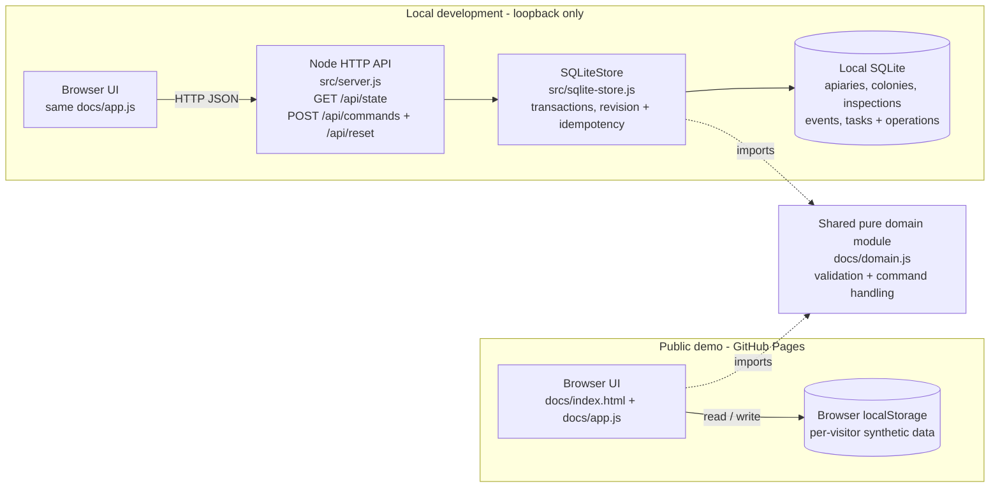

# HiveLedger — Beekeeping Operations Demo

**Engineering case study:** Domain rules, transactional persistence and traceable history for a small beekeeping operations system. This is a simplified public implementation, not the private application.

**[Live interactive demo](https://pfirsowicz.github.io/beekeeping-operations-demo/)** · **[Latest release: v1.1.0](https://github.com/pfirsowicz/beekeeping-operations-demo/releases/tag/v1.1.0)** · **[CI](https://github.com/pfirsowicz/beekeeping-operations-demo/actions/workflows/ci.yml)**


## Engineering decisions and evidence

- **Stable identity and chronology:** A colony retains its ID when moved; later activity cannot be silently invalidated by backdated operations. [Domain rules](docs/domain.js) · [Domain tests](test/domain.test.js).
- **Transactional, repeat-safe writes:** Local SQLite commands use foreign keys, a transaction, an operation ID for idempotent retry and an expected revision to reject conflicting edits. [Persistence implementation](src/sqlite-store.js) · [Database tests](test/sqlite.test.js).
- **Explainable history:** Inspection edits record before/after values, and relocation events preserve source and destination. Unknown observations remain distinct from a measured zero. [Domain rules](docs/domain.js) · [API tests](test/api.test.js).

## Operational context and public scope

I use a **separate, private beekeeping application** to manage my own apiaries. The requirements illustrated here come from operational problems I encounter: recording inspections, scheduling follow-ups, relocating colonies without losing history and correcting observations without rewriting earlier events. This repository represents selected workflows in a smaller public codebase; it is **not** the private source code or a copy of the production system.

The public app is intentionally bounded. All locations, colonies and observations are **synthetic**. There are no private records, credentials or production connections. The repository and its tests show what the public version implements; they do not establish the security or completeness of the private application.

## Two distinct runtime modes

- **Hosted GitHub Pages demo:** Static HTML/JavaScript with isolated, per-visitor browser `localStorage`. It has **no hosted Node/SQLite backend**, shared accounts or connection to production. Use the live demo to explore the workflows.
- **Locally runnable Node/SQLite API:** A separate loopback-only server and relational persistence adapter, exercised by the automated tests. It is **not deployed on GitHub Pages**. See [server](src/server.js), [SQLite store](src/sqlite-store.js) and [local setup](#run-locally).

This separation is deliberate: the interactive hosted frontend demonstrates the workflow, while the local implementation makes persistence and concurrency rules inspectable.

## Features

| Workflow | What the demo does |
| --- | --- |
| Apiary overview | Three sample locations and calculated active-colony counts |
| Colony register | Search/filter by site; stable colony identity and latest inspection evidence |
| Inspections | Create/edit structured queen observations, brood-frame counts, stores, temperament and notes |
| Follow-ups | Schedule from an inspection, update/cancel through editing, complete with a recorded event |
| Colony relocation | Move between apiaries while retaining original source/destination, date and reason |
| History | Combined colony timeline, location moves and append-only audit events with edited-value deltas |
| Safety | Domain validation, relational constraints, transactional writes, idempotency, revision conflicts |
| Appearance | Harvest (green and honey) or Studio (neutral CRM) theme; visitor-local preference |

### The distinctive workflow: move a colony

1. Inspect **COL-101** in fictional **Fern Ridge**.
2. Open the colony and choose **Move colony** → **Stonefield**.
3. The register immediately shows Stonefield, while all previous inspections retain their original colony ID.
4. The timeline still includes the `Fern Ridge → Stonefield` event.
5. The service rejects a move dated earlier than the colony's latest activity.

### Architecture



**The hosted static and local REST experiences are intentionally different persistence adapters.** GitHub Pages uses visitor-local browser storage because it cannot host a server or shared database. The local API uses normalized, foreign-key-enforced SQLite tables to show real transactional data handling. Neither mode talks to production.

## Run locally

Requires **Node.js 22.13+** (Node.js 24 also supported). No `npm install`, account, API key or external service is required.

```bash
npm run check
npm test
npm run audit:public
npm start
```

Open **http://127.0.0.1:3000**. Local development uses the SQLite-backed API. By default the database is in memory; changes persist while the server is running. To keep local demo state across restarts, set `DEMO_DB_PATH` to an isolated `.db` file in your development environment; database files are excluded by `.gitignore`.

To check the browser-only deployment path locally, open **http://127.0.0.1:3000/?offline=1**. It uses localStorage and does not call the API. The **Reset sample data** control clears only demo records.

## Live demo and public release

**[Open HiveLedger](https://pfirsowicz.github.io/beekeeping-operations-demo/)** — a free, browser-based synthetic-data demo. Choose **Harvest** or **Studio** from the Appearance selector. Inspection, follow-up and colony-move actions in the hosted experience affect only your own browser's local demo storage.

**[Version v1.1.0](https://github.com/pfirsowicz/beekeeping-operations-demo/releases/tag/v1.1.0)** — the current All Rights Reserved simplified public demo release. GitHub provides source archives automatically.

## Quality and validation

Run `npm test` to exercise:

- Domain validation and unknown-versus-zero preservation
- Create/edit/complete follow-ups and auditable before/after changes
- Consistent relocations, invalid destinations and chronology rejection
- SQLite foreign-key enforcement, persistence and rollback
- Idempotent retry after uncertain writes and optimistic concurrency conflicts
- HTTP request/response integration and static asset boundary checks

GitHub Actions CI runs syntax checks, all Node tests and publication checks on pushes and pull requests. PR and post-merge checks passed on Node 22 and 24. Browser-level regression testing remains a distinct acceptance activity.

## Repository structure

```text
.github/workflows/ci.yml      Node 22 / Node 24 checks and tests
docs/                         Static public demo for GitHub Pages
  index.html, styles.css      Responsive UI
  theme.css, theme.js         Original Harvest / Studio visual themes
  app.js                      Browser workflows and storage adapter
  domain.js                   Shared pure domain rules
  seed.js                     Synthetic fixture generator
src/server.js                 Loopback-only Node HTTP API
src/sqlite-store.js           Normalized, transactional SQLite implementation
test/                         Domain, database and HTTP integration tests
scripts/publication-check.js  Basic public-source safeguard
LICENSE                       All Rights Reserved for original demo code
```

## Deliberate limitations

- This is a **simplified public version of an existing beekeeping application**.
- The public version has **no shared accounts or sync**, so every visitor has independent local data.
- The API is **local-only** and unauthenticated, with no production-grade rate limits or deployment hardening.

## Copyright

**Copyright © 2026 Pawel Firsowicz. All rights reserved.** The current original demo is not licensed for copying, redistribution, commercial deployment or modification without written permission.
