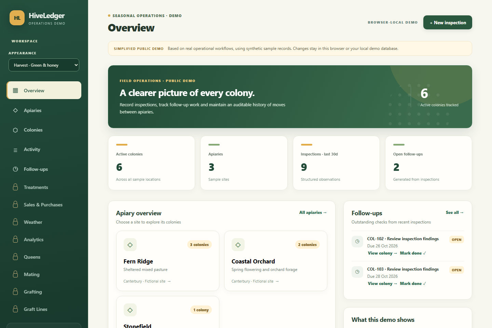
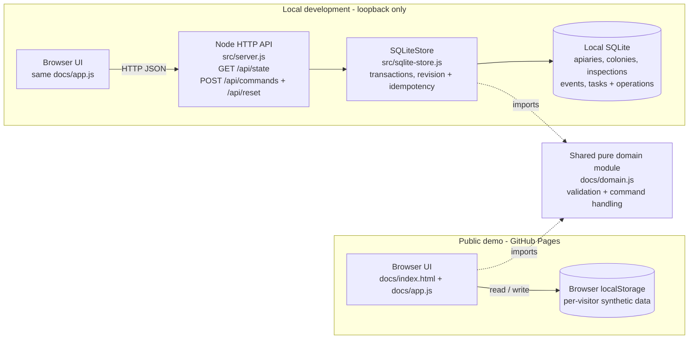

# HiveLedger — Beekeeping Operations Demo

**A simplified public demo of the beekeeping operations application I use to manage my own apiaries — featuring inspections, follow-ups, colony history and transactional consistency.**

**[Live interactive demo](https://pfirsowicz.github.io/beekeeping-operations-demo/)** · **[Latest release: v1.0.1](https://github.com/pfirsowicz/beekeeping-operations-demo/releases/tag/v1.0.1)** · **[CI](https://github.com/pfirsowicz/beekeeping-operations-demo/actions/workflows/ci.yml)**



**Release status (24 October 2026):** GitHub Pages deployed and checked in a live Chromium browser; PR and post-merge Node 22/24 CI passed. End-to-end cross-browser testing remains future work.

HiveLedger presents a simplified set of workflows from an existing beekeeping application that I actively use for my own operations. This public version is implemented separately from the private system and does not connect to it. **The apiaries, colonies, observations and event history supplied with this demo are synthetic sample data.** No private records, credentials, operational database or production infrastructure are included.

## Why this project

A beekeeping operation involves more than CRUD: colony identity must survive a move, inspection observations must distinguish *unknown* from *zero*, follow-up tasks need lifecycle state, and a backdated operation must not silently falsify the location history.

This public version showcases those established operational workflows in a smaller, inspectable codebase. The full private application remains in active use and is not included in this repository.

## Features

| Workflow | What the demo does |
| --- | --- |
| Apiary overview | Three sample locations and calculated active-colony counts |
| Colony register | Search/filter by site; stable colony identity and latest inspection evidence |
| Inspections | Create/edit structured queen observations, brood-frame counts, stores, temperament and notes |
| Follow-ups | Schedule from an inspection, update/cancel through editing, complete with a recorded event |
| Colony relocation | Move between apiaries while retaining original source/destination, date and reason |
| History | Combined colony timeline, location moves and append-only audit events with edited-value deltas |
| Safety | Domain validation, relational constraints, transactional writes, idempotency, revision conflicts |
| Appearance | Harvest (green and honey) or Studio (neutral CRM) theme; visitor-local preference |

### Advanced modules shown as premium previews

The main navigation includes **Treatments, Sales & Purchases, Weather, Analytics, Queens, Mating, Grafting and Graft Lines**, directly below Follow-ups, using lock icons rather than the ordinary navigation icons. Hovering or keyboard-focusing these items shows **“Available in the full application (premium)”**. They illustrate the broader product capabilities but are **not implemented or accessible in this public demo**. They expose no route, API, login, checkout or premium subscription. This is not a currently purchasable upgrade.

### The distinctive workflow: move a colony

1. Inspect **COL-101** in fictional **Fern Ridge**.
2. Open the colony and choose **Move colony** → **Stonefield**.
3. The register immediately shows Stonefield, while all previous inspections retain their original colony ID.
4. The timeline still includes the `Fern Ridge → Stonefield` event.
5. The service rejects a move dated earlier than the colony's latest activity.

### Architecture



**The hosted static and local REST experiences are intentionally different persistence adapters.** GitHub Pages uses visitor-local browser storage because it cannot host a server or shared database. The local API uses normalized, foreign-key-enforced SQLite tables to show real transactional data handling. Neither mode talks to production.

## Run locally

Requires **Node.js 22.13+** (Node.js 24 also supported). No `npm install`, account, API key or external service is required.

```bash
npm run check
npm test
npm run audit:public
npm start
```

Open **http://127.0.0.1:3000**. Local development uses the SQLite-backed API. By default the database is in memory; changes persist while the server is running. To keep local demo state across restarts, set `DEMO_DB_PATH` to an isolated `.db` file in your development environment; database files are excluded by `.gitignore`.

To check the browser-only deployment path locally, open **http://127.0.0.1:3000/?offline=1**. It uses localStorage and does not call the API. The **Reset sample data** control clears only demo records.

> The local API is deliberately bound to `127.0.0.1` and has **no authentication**. Do not expose it to the public Internet or use it for real beekeeping data. `node:sqlite` is marked experimental in Node.js 22; pin and reassess Node support before treating this as a production template.

## Live demo and public release

**[Open HiveLedger](https://pfirsowicz.github.io/beekeeping-operations-demo/)** — a free, browser-based synthetic-data demo. Choose **Harvest** or **Studio** from the Appearance selector. Inspection, follow-up and colony-move actions in the hosted experience affect only your own browser's local demo storage.

**[Version v1.0.1](https://github.com/pfirsowicz/beekeeping-operations-demo/releases/tag/v1.0.1)** — the current All Rights Reserved simplified public demo release. GitHub provides source archives automatically.

**Deployment evidence (24 October 2026):** public GitHub Pages returned HTTP 200 for its index and theme/application assets, and a headless Chrome smoke check rendered the Harvest dashboard, metrics, apiary overview and theme selector. The [post-merge CI run](https://github.com/pfirsowicz/beekeeping-operations-demo/actions/runs/40020136403) passed on Node 22 and 24. These are not a substitute for complete manual desktop/mobile interaction testing.

GitHub Pages uses the static `main` branch `/docs` directory. New versions should pass tests and review before being tagged; source releases and public site deployment are separate gates. The public repository uses no billable database, custom runner or hosting service.

## Quality and validation

Run `npm test` to exercise:

- Domain validation and unknown-versus-zero preservation
- Create/edit/complete follow-ups and auditable before/after changes
- Consistent relocations, invalid destinations and chronology rejection
- SQLite foreign-key enforcement, persistence and rollback
- Idempotent retry after uncertain writes and optimistic concurrency conflicts
- HTTP request/response integration and static asset boundary checks

`npm run audit:public` scans authored implementation and workflow sources for recognised credential patterns and production references, and rejects common accidentally included secret files. This is **not** a complete secret-scanning certification. Also review commit history, GitHub secret-scanning alerts and any added images/dependencies before making the repository public.

GitHub Actions CI runs syntax checks, all Node tests and publication checks on pushes and pull requests. PR and post-merge checks passed on Node 22 and 24. Browser-level regression testing remains a distinct acceptance activity.

## Repository structure

```text
.github/workflows/ci.yml      Node 22 / Node 24 checks and tests
docs/                         Static public demo for GitHub Pages
  index.html, styles.css      Responsive UI
  theme.css, theme.js         Original Harvest / Studio visual themes
  app.js                      Browser workflows and storage adapter
  domain.js                   Shared pure domain rules
  seed.js                     Synthetic fixture generator
src/server.js                 Loopback-only Node HTTP API
src/sqlite-store.js           Normalized, transactional SQLite implementation
test/                         Domain, database and HTTP integration tests
scripts/publication-check.js  Basic public-source safeguard
LICENSE                       All Rights Reserved for original demo code
```

## Deliberate limitations

- This is a **simplified public version of an existing, privately used beekeeping application**. It does not contain authoritative operational records and must not be used as a regulatory or accounting record.
- The public version has **no shared accounts or sync**, so every visitor has independent local data.
- The API is **local-only** and unauthenticated, with no production-grade rate limits or deployment hardening.
- No real queen lineage, treatments, grafting, finance, commercial analytics, private schema or Supabase RPCs are present.
- The public static site has been verified live, but full interactive desktop/mobile, keyboard and cross-browser regression acceptance is not yet complete.

## Further work worth demonstrating

Browser end-to-end tests (Playwright), an accessible keyboard/form review, property-based chronology tests, data export/import, a versioned SQLite migration runner, and API auth/authorization would make sense if this were expanded. Avoid extra features that obscure the four core workflows.

## Copyright and separation

**Copyright © 2026 Pawel Firsowicz. All rights reserved.** The current original demo code is publicly viewable for portfolio evaluation; it is not licensed for copying, redistribution, commercial deployment or modification without written permission. The underlying private beekeeping application and its implementation, schemas, data, domain operations, assets and business features are **not** licensed or included here. This public subset was implemented independently and contains synthetic records; it does not publish the private system's source code, schema, infrastructure or data.
